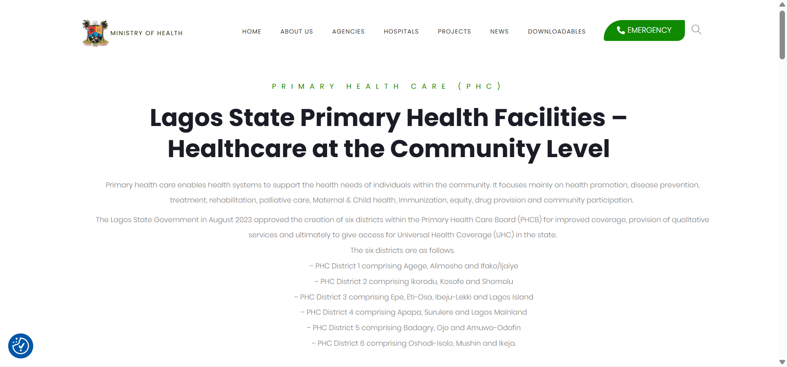
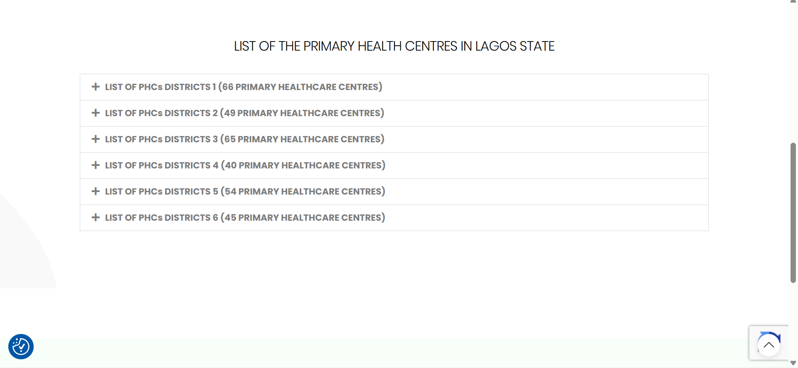
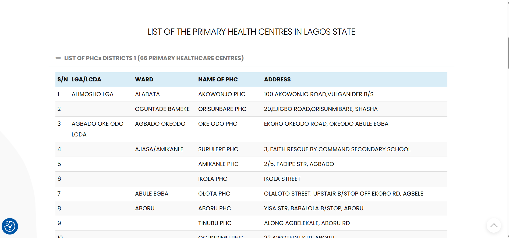
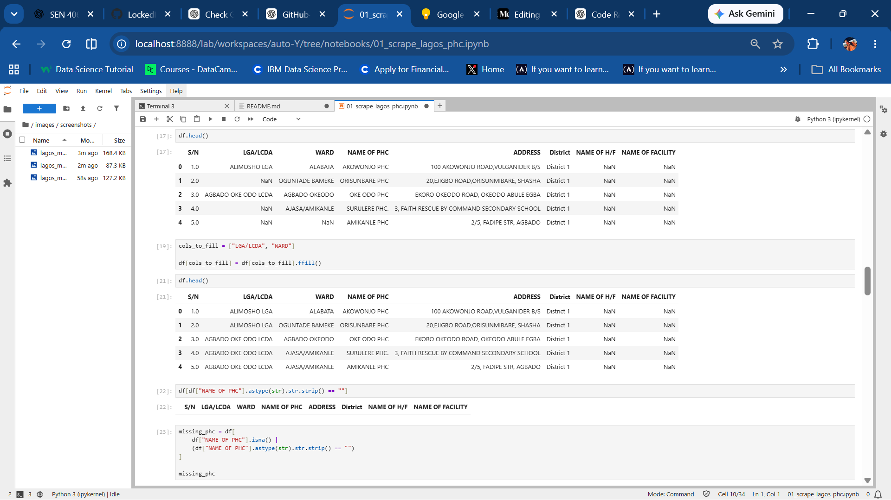
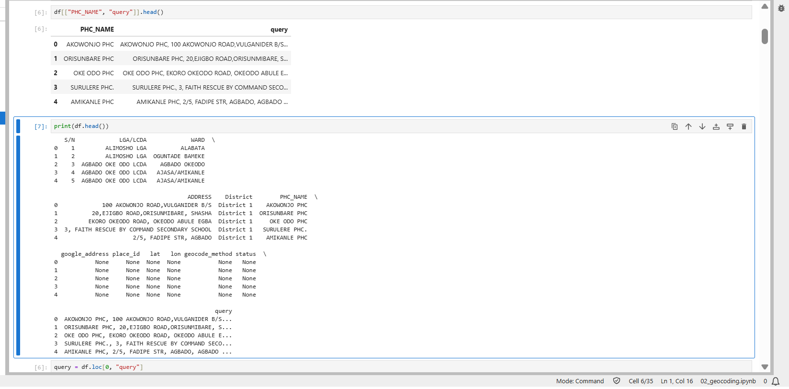
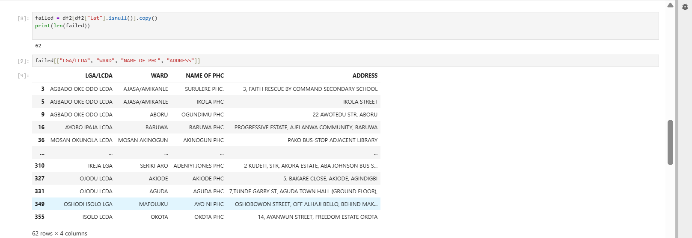
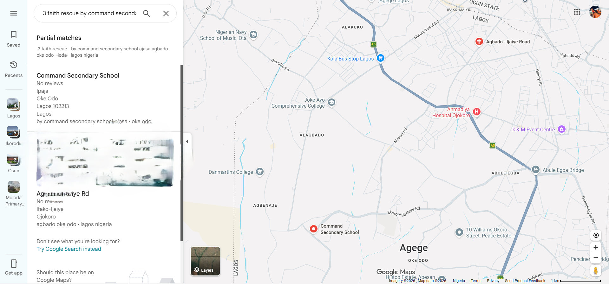
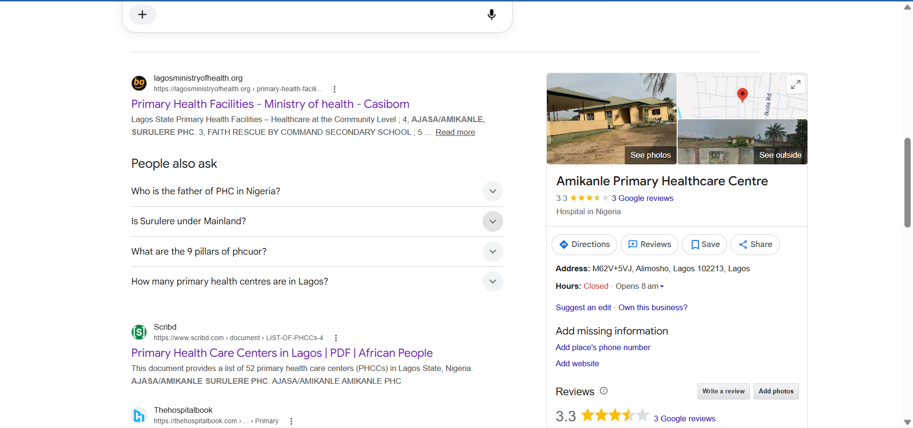
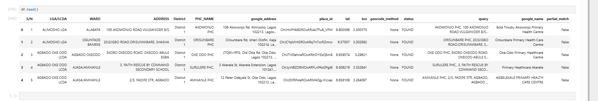

# Lagos PHC Geocoding Pipeline

## Project Overview
Accurate geographic coordinates are essential for healthcare planning, accessibility analysis, emergency response, and route optimisation. However, many publicly available health facility datasets contain incomplete, inconsistent, or outdated address information, making reliable geocoding difficult.

This project presents a multi-stage geocoding pipeline developed for Primary Health Centres (PHCs) in Lagos State, Nigeria. The workflow combines web scraping, data cleaning, Google Places API, and Google Geocoding API to improve the completeness and accuracy of health facility locations.

The final output is a cleaned, geocoded dataset containing facility names, standardised addresses, verified Google addresses, geographic coordinates, and metadata describing the geocoding method used for each facility.

This project also serves as the foundation for future geospatial analyses, including healthcare accessibility studies and route optimisation for medical logistics.

The resulting dataset can be used directly in GIS software such as QGIS or ArcGIS for mapping, accessibility analysis, healthcare planning, and route optimisation.

## Problem Statement
Although lists of Primary Health Centres are publicly available, many facilities lack standardised or easily geocodable addresses. Inconsistent formatting, missing information, and outdated address records often reduce geocoding success and limit the usefulness of these datasets for spatial analysis.

A reliable geocoding workflow is therefore required to transform these records into accurate geographic coordinates while preserving the original source information and maintaining transparency about how each location was obtained.
## Objectives

The objectives of this project are to:

- Scrape publicly available Primary Health Care (PHC) facility information from the Lagos State Ministry of Health website.
- Clean and preprocess the extracted dataset for automated geocoding.
- Construct enriched geocoding queries by combining facility names with administrative location information.
- Retrieve PHC locations using the Google Places API.
- Use the Google Geocoding API as a fallback for facilities that could not be matched through the Places API.
- Record the geocoding method used for each facility.
- Produce a clean geospatial dataset suitable for GIS analysis and mapping.
## Dataset

### Data Source

The dataset used in this project was obtained from the **Lagos State Ministry of Health**. It contains information on Primary Health Care (PHC) facilities across Lagos State, including facility names, addresses, wards, Local Government Areas/Local Council Development Areas (LGA/LCDAs), and PHC districts.

The data was published as an HTML table on the Ministry's website and was programmatically extracted using Python for further processing.

**Official Source:**  
[Lagos State Ministry of Health – Primary Health Facilities](https://lagosministryofhealth.org/primary-health-facilities/)






### Data Preprocessing

Before geocoding, the extracted dataset was cleaned and prepared to improve data consistency and maximise geocoding accuracy.

The preprocessing workflow included:

- **Forward-filling administrative information:** The source table omitted repeated **LGA/LCDA** and **Ward** values by leaving subsequent cells blank. These missing values were forward-filled so that every facility retained the correct administrative information.


- **Merging facility name columns:** Facility names were stored across three different columns (`NAME OF PHC`, `NAME OF H/F`, and `NAME OF FACILITY`). These were merged into a single `PHC_NAME` column to create a consistent field for subsequent processing.

- **Constructing enriched geocoding queries:** A search query was created by combining the facility name, address, LGA/LCDA, and state into a single string. Providing additional contextual information helped improve the accuracy of the Google Places and Geocoding APIs compared to using addresses alone.

- **Preparing records for automated geocoding:** Created placeholder columns (`google_address`, `place_id`, `lat`, `lon`, `geocode_method`, and `status`) to store the results returned by the Google Maps APIs during the geocoding process.

The resulting dataset served as the input for the automated geocoding workflow.


> **Note:** The Lagos State Ministry of Health website was used as the authoritative source for the original facility information. The geocoding process added geographic coordinates and Google's standardized addresses while preserving the original facility records.


## Methodology
The geocoding workflow was implemented as a multi-stage pipeline to maximize geocoding success while preserving the original dataset.

The workflow consisted of the following stages:

1. Web scraping of the publicly available PHC dataset.
2. Data cleaning and preprocessing.
3. Facility name consolidation and geocoding query construction.
4. Facility lookup using the Google Places API.
5. Address verification and geocoding using the Google Geocoding API.
6. Recording of the geocoding method used for each facility.
7. Export of the cleaned geocoded dataset for GIS applications.

## Geocoding Strategy

The geocoding workflow evolved through iterative testing and refinement.

### Initial Approach

The initial approach relied on the facility addresses published on the Lagos State Ministry of Health website. These addresses were submitted to the Google Geocoding API to retrieve geographic coordinates. While many facilities were successfully geocoded, a number of records returned no results.

### Investigating Failed Matches

To understand why some records failed, the unmatched facilities were manually investigated using Google Maps. This revealed that:

- Some of the published addresses could not be found on Google Maps.
  
- Searching by address often returned no results
  
- Whereas searching by the facility name successfully identified the PHC.
  
- In several cases, the address recognised by Google Maps differed from the address published on the source website, suggesting that the published address was outdated, incomplete, or different from the address under which the facility was registered in Google's database.

### Improving the Geocoding Workflow

To improve address-based geocoding, an enriched search query was created by combining the facility name, address, LGA/LCDA, state, and country into a single query. This provided additional context to the Google Geocoding API and improved the number of successful matches.

However, some facilities still could not be geocoded.

Further testing showed that many PHCs were more reliably recognised by Google as **named places** rather than by their published street addresses. Based on this observation, the workflow was redesigned to use the **Google Places API** as the primary lookup service. Each facility was first searched using its name and LGA/LCDA. If no suitable match was found, the workflow automatically fell back to the **Google Geocoding API** using the enriched query.

### Preserving the Original Dataset

To preserve the original facility records while storing Google's standardised information, additional columns were added to the dataset, including:

- `google_name`
- `google_address`
- `place_id`
- `lat`
- `lon`
- `geocode_method`
- `status`

This multi-stage approach produced a more robust geocoding workflow while maintaining the integrity of the original data obtained from the Lagos State Ministry of Health.
Example of a facility where the address returned by Google Maps differed from the address published on the source website.


## Project Workflow

```text
Lagos State Ministry of Health Website
                │
                ▼
        Web Scraping (HTML Table)
                │
                ▼
      Data Cleaning & Preprocessing
                │
                ▼
      Merge Facility Name Columns
                │
                ▼
   Construct Enriched Geocoding Queries
                │
                ▼
      Google Places API (Primary)
                │
      Match Found?
         │              │
       Yes              No
         │              │
         ▼              ▼
 Store Result     Google Geocoding API
                        │
                 Match Found?
                    │         │
                  Yes         No
                    │         │
                    ▼         ▼
              Store Result   Mark as FAILED
                    │
                    ▼
        Export Final Geocoded Dataset
```
## Technologies Used

- Python
- Pandas
- BeautifulSoup
- Requests
- Google Maps Platform
    • Google Places API
    • Google Geocoding API
- JupyterLab
- Git
- GitHub

## Project Structure

```text
lagos-phc-geocoding-pipeline/
│
├── data/
│   ├── raw/
│   ├── processed/
│   └── outputs/
│
├── docs/
├── images/
├── notebooks/
├── scripts/
│
├── config.py
├── requirements.txt
├── README.md
├── .gitignore
└── .env.example
```
## Results

The multi-stage geocoding workflow successfully transformed a publicly available list of Lagos State Primary Health Centres into a geospatially enriched dataset.
Total facilities processed: 325
Successfully geocoded: 325
Failed: 0
Retrieved through Google Places API: 250

Retrieved through Google Geocoding API: 68

Failed matches: 0
The final dataset includes:

- Cleaned and standardized facility names
- Original facility addresses
- Google-standardized addresses
- Latitude and longitude coordinates
- Google Place IDs
- Geocoding method used for each record

The workflow improved geocoding reliability by combining Google Places API and Google Geocoding API, while preserving the original government-provided address information for transparency and traceability.
## Sample Output


## Future Work

This project serves as the foundation for several future geospatial studies.

Planned extensions include:

- Interactive visualization of PHCs using Folium.
- Spatial accessibility analysis of Primary Health Centres across Lagos State.
- Route optimization for vaccine and medical supply distribution.
- Comparative analysis of government-recorded addresses and Google-verified locations.
- Development of a research paper on improving geocoding accuracy for healthcare datasets using multi-stage geocoding techniques.
## Installation

Clone the repository:

```bash
git clone https://github.com/YOUR_USERNAME/lagos-phc-geocoding-pipeline.git
```

Navigate to the project directory:

```bash
cd lagos-phc-geocoding-pipeline
```

Install the required packages:

```bash
pip install -r requirements.txt
```

Create a `.env` file and add your Google Maps API key:

```text
GOOGLE_API_KEY=YOUR_API_KEY
```
## Usage

Run the notebooks in the following order:

1. `01_scrape_lagos_phc.ipynb`
2. `02_geocoding.ipynb`

The final geocoded datasets will be saved in the `data/processed/` directory.
## References

1. Lagos State Ministry of Health. *Primary Health Facilities*. https://lagosministryofhealth.org/primary-health-facilities/

2. Google Maps Platform Documentation. https://developers.google.com/maps

3. Google Geocoding API Documentation. https://developers.google.com/maps/documentation/geocoding

4. Google Places API Documentation. https://developers.google.com/maps/documentation/places
## Author

**ASHOGBON ADEWALE EMMANUEL**

Software Engineering Department  
Osun State University, Osogbo

Interested in:

- Geospatial Data Science
- GIS
- Machine Learning
- Healthcare Analytics